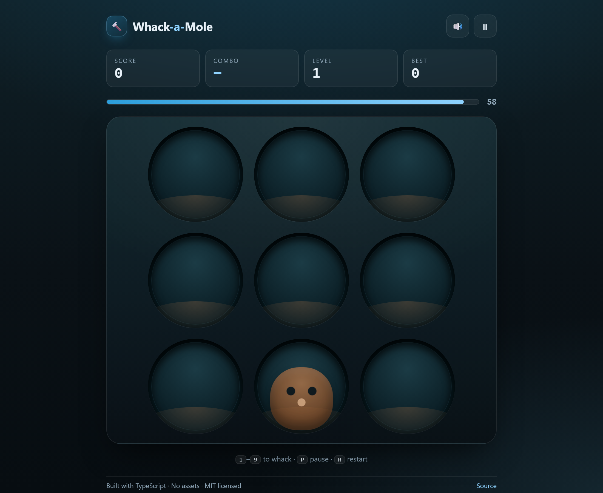

<div align="center">

# 🔨 Whack-a-Mole

**Sixty seconds. Nine holes. Combos, golden moles and bombs.**

A polished, accessible whack-a-mole built with **TypeScript + Vite**, with **zero runtime dependencies** and **zero image/audio assets** — every sound is synthesised at runtime and the whole game gzips to ~15 KB.

The shipped interface is **zh-CN only** (PRD N5); all player-facing strings live in [`src/copy.ts`](src/copy.ts) so another language is a data change, not a code change.

[](https://github.com/you0172/whack-a-mole/actions/workflows/ci.yml)
[](https://github.com/you0172/whack-a-mole/actions/workflows/deploy.yml)
[](LICENSE)
[](tsconfig.json)
[](package.json)
[](tests/)

### ▶️ [Play it now](https://you0172.github.io/whack-a-mole/)

[](https://you0172.github.io/whack-a-mole/)

</div>

---

## ✨ Why this one is different

Most whack-a-mole clones are a `setInterval` and nine `onclick`s. This one is built like a real product:

|                         |                                                                                                          |
| ----------------------- | -------------------------------------------------------------------------------------------------------- |
| 🧠 **Testable core**    | All rules live in a pure engine with injected randomness — 93 tests, **99.6% coverage**, no DOM required |
| 🎯 **Real game design** | Combo multiplier, golden moles, bombs, six difficulty levels, personal bests                             |
| 🔇 **Zero assets**      | No PNGs, no MP3s. Moles and sounds are generated by CSS gradients and Web Audio                          |
| ♿ **Accessible**       | Every hole is a `<button>`, keys `1`–`9` work, actions are announced via `aria-live`                     |
| 📱 **Responsive**       | Plays on phones, honours `prefers-reduced-motion`                                                        |
| 🪶 **Tiny**             | ~24 KB JS + ~14 KB CSS raw; **15 KB gzipped total**, gated in CI against a 20 KB budget                  |

---

---

## 🆕 What's new in v2.0

This release implements **PRD v2.0-a** — the feel-and-goal milestone.

| Area       | v1                                         | v2.0                                                                                                   |
| ---------- | ------------------------------------------ | ------------------------------------------------------------------------------------------------------ |
| Difficulty | 12 s per level, so level 6 was unreachable | 10 s per level, all six fit the 60 s round                                                             |
| Target mix | random from the first second               | L1 normal only, golden from L2, bombs from L3; weights 70 / 12 / 18                                    |
| Fairness   | —                                          | no same-hole repeat within 2 spawns, no bomb + golden together, 120 ms breathing gap, 650 ms ttl floor |
| Goal       | none                                       | one reachable round goal, **+20%** bonus counted into the record                                       |
| Daily      | none                                       | seeded daily challenge from the local date                                                             |
| Feedback   | flash + beep                               | hole press, 4–6 particles, floating score (max 4 on screen), 3× frame glow, §4.6 sound spec            |
| Settlement | stat list                                  | score → record → best combo → goal result → play again, readable in three seconds                      |
| Pause      | freezes ticks                              | freezes the level clock too, and ignores prerender/background prefetch                                 |
| Storage    | one high-score key                         | `wam.save.v1` with additive migration — a schema change never wipes your records                       |
| Analytics  | none                                       | the eight PRD events, buffered in memory — **nothing leaves the page**                                 |

Deliberately **not** in this milestone: offline PWA (R13, SHOULD), share card (v2.0-c), leaderboards (N2), accounts (N1).

## ✅ Verifying a build

```bash
npm run verify   # typecheck + 86 tests with coverage + build + 20 KB gzip gate
npm run smoke    # headless Edge plays a real round over CDP, writes artifacts/
```

`npm run smoke` expects a build at `http://localhost:4173` (`npm run preview`) and a Chromium instance started with `--remote-debugging-port=9222`. It checks what unit tests cannot: interactive under 1 s, first target within 400 ms, keyboard **and** pointer hits, the mole staying clipped inside its hole (the v1 "mole paints over the footer" class of bug), settlement appearing on its own, and play-again in under a second.

## 🎮 How to play

| Action         | Keyboard                    | Mouse / touch         |
| -------------- | --------------------------- | --------------------- |
| Whack a hole   | <kbd>1</kbd> … <kbd>9</kbd> | Click / tap the hole  |
| Pause / resume | <kbd>P</kbd>                | ⏸ button              |
| Restart        | <kbd>R</kbd>                | Button on the overlay |
| Start          | <kbd>Space</kbd>            | Start button          |

### Rules

| Mole       | Points               | Notes                                   |
| ---------- | -------------------- | --------------------------------------- |
| 🐹 Normal  | **+10 × multiplier** | The bread and butter                    |
| 🌟 Golden  | **+50 × multiplier** | Rarer and disappears faster             |
| 💣 Bomb    | **−25**              | Breaks your combo. Don't hit it.        |
| 💨 Escaped | 0                    | A mole that times out resets your combo |

**Combo multiplier:** every 5 consecutive hits raises the multiplier by 1×, up to **5×**. A bomb or an escaped mole resets it.

**Difficulty:** six levels, one every **10 seconds** so all six fit inside the 60 s round (the v1 build used 12 s, which made the last level unreachable). Higher levels spawn faster and shorten how long a target stays; level 1 only ever shows normal moles, golden moles start at L2 and bombs at L3.

**Round goal:** every round gets one reachable goal (`连击到 3×`, `本局拿到 500 分`, `命中 3 只金鼠`, `命中 30 次`). Meeting it adds **+20%** to the final score, and that bonus counts towards your personal best.

**Daily challenge:** the start screen offers one seeded round per day — same seed, same sequence, for everyone who plays that day.

**Ranking:** `Warming Up → Rookie → Getting Warm → Sharpshooter → Mole Hunter → Legendary`.

---

## 🚀 Getting started

```bash
# Node 20+ required
git clone https://github.com/you0172/whack-a-mole.git
cd whack-a-mole
pnpm install
pnpm dev          # http://localhost:5173
```

### Scripts

| Script           | What it does                                |
| ---------------- | ------------------------------------------- |
| `pnpm dev`       | Vite dev server with HMR                    |
| `pnpm build`     | Typecheck + production build into `dist/`   |
| `pnpm preview`   | Serve the production build locally          |
| `pnpm test`      | Run the unit test suite (Vitest)            |
| `pnpm coverage`  | Test with a V8 coverage report + thresholds |
| `pnpm lint`      | ESLint (type-aware)                         |
| `pnpm format`    | Prettier write                              |
| `pnpm typecheck` | `tsc --noEmit`                              |

---

## 🏗️ Architecture

```
src/
├── game/                 # pure logic — no DOM, no side effects
│   ├── engine.ts         # state machine: spawn, whack, tick, escape
│   ├── difficulty.ts     # level curve → spawn interval & ttl
│   ├── scoring.ts        # combo multiplier, points, ranks
│   └── types.ts          # GameConfig, snapshots, events
├── ui/                   # thin DOM adapters
│   ├── board.ts          # 3×3 holes, reconciled per frame
│   ├── hud.ts            # writes only what changed
│   └── overlay.ts        # start / pause / results
├── audio/sfx.ts          # Web Audio synthesis (no files)
├── storage/highscores.ts # localStorage with failure tolerance
├── styles/main.css       # design tokens + all visuals
└── main.ts               # wiring, rAF loop, input
```

**The important boundary:** `game/` never imports from `ui/`. The engine takes a `RandomSource` in its constructor, so tests can drive it deterministically:

```ts
const engine = new GameEngine({ holes: 3, baseTtlMs: 100 }, seededRandom(42));
engine.start();
engine.tick(100);
const [mole] = engine.snapshot.moles;
engine.whack(mole.hole); // → { outcome: 'hit', points: 10, combo: 1 }
```

This is why the whole rulebook is testable without a browser or a fake DOM.

---

## ✅ Quality gates

Every push and pull request runs:

```
lint → format:check → typecheck → test → build
```

Current state:

- **41 tests** across engine, scoring, difficulty and storage
- **98.85%** statement coverage on `src/game/**` (thresholds: 85/85/75/85)
- Strict TypeScript, including `noUncheckedIndexedAccess`
- `pnpm-lock.yaml` committed; CI installs with `--frozen-lockfile`

---

## ♿ Accessibility

- Holes are real `<button>` elements — native focus, Enter/Space activation, screen-reader labels
- Full keyboard play with <kbd>1</kbd>–<kbd>9</kbd>, plus <kbd>P</kbd> / <kbd>R</kbd> / <kbd>Space</kbd>
- Hits, combos, level-ups and rank changes are announced through a polite `aria-live` region
- Visible focus rings (`:focus-visible`) on every interactive element
- `prefers-reduced-motion` disables pop, squash and ring animations
- Colour is never the only signal: golden and bomb moles differ in shape and label too

---

## 🗺️ Roadmap

- [ ] Sound theme selector
- [ ] Endless mode with accelerating spawn
- [ ] Daily challenge seeded from the date
- [ ] Local leaderboard for multiple players

Ideas and PRs welcome — see [CONTRIBUTING.md](CONTRIBUTING.md).

---

## 📄 License

[MIT](LICENSE) © you0172

<sub>Built with TypeScript, Vite and Web Audio. No frameworks were harmed.</sub>
